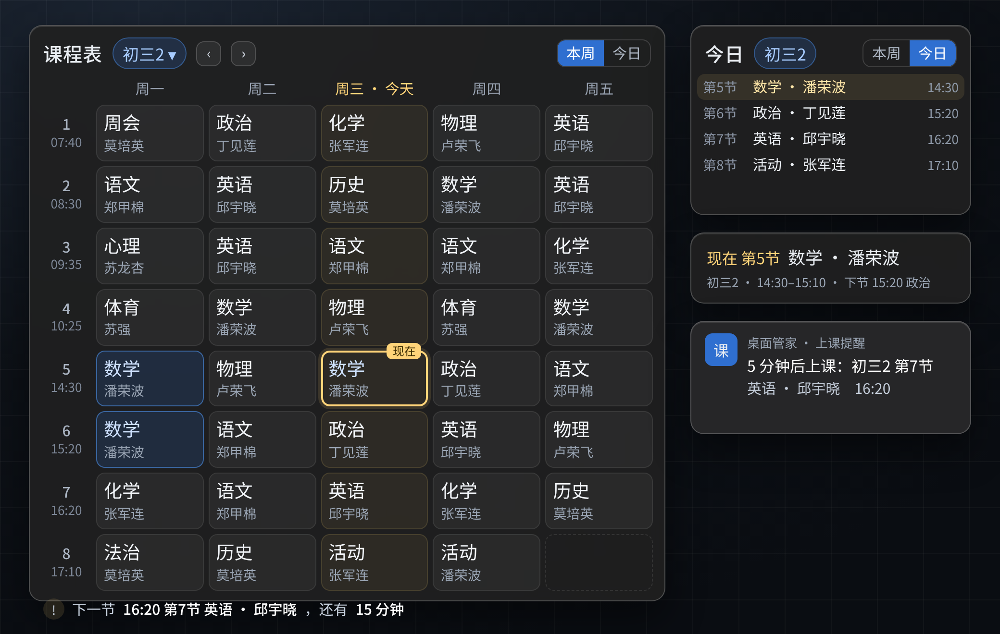

# 桌面管家课程表格子与上课提醒实施方案

面向版本：GUI 1.10.x（不加引擎改动）\
依据：2026-11-28 的现有代码；26-27 第一学期总课程表实跑数据\
交付形态：桌面格子（WidgetKind.Timetable）＋ 设置页导入与提醒 ＋ 课前系统通知

## 一 结论先行

一句话：**在桌面管家里加一个新功能格子，一份课表 JSON，导入一次全学期可用；提醒只做「课前 N 分钟」，复用现有通知通道，不碰引擎、不加设置字段。**

五个关键决定，先摆出来：

1. **数据一份、三处存放**：整份课表放资料库（随坚果云双机共用），本机留缓存，本机设置（看哪个班、提醒开关、作息时间）单独一个文件，不进 AppSettings —— 设置 schema 是冻结的，加字段会撞四个契约测试，绕开比改基线划算。
2. **导入以「粘贴」为主通道**：从 WPS/Excel 里整块复制课表直接粘进来，这条路对 .xls、.xlsx、任何排法都成立；.xlsx 再补一条文件直读；**.xls 二进制不自研解析**，提示另存或粘贴。宁可少做，不做半准的解析器。
3. **解析完先出「导入体检」，人点头才落盘**：识别到几个班、多少节、哪些格子可疑（用你这份总表实跑：14 个班、每班 39 节、9 处科目栏与教师栏互相串位、教师同节冲突 0 处），细节见第四节。
4. **样式不新造**：圆角、边框、材质、透明度全部走现有格子主题，课程表只定义四个语义色（我的课、今天列、当前节、空节），由当前主题色派生。
5. **提醒与格子同生共死**：关掉格子就停提醒，避免「桌面看不见、通知还在响」的幽灵行为；toast 不可用时降级为格子底栏常显倒计时，绝不静默失败。

界面形态见下页插图：周视图、今日视图、收起胶囊、系统通知四种形态。

{width=15cm}

## 二 现有架构里能复用什么

先把「要改哪儿」摸清楚，再谈方案。下表是逐项查过代码后的结论，全部是现成能力，**不需要改 Go 引擎，也不需要引第三方库**。

| 需要的能力 | 现在的落点 | 复用方式 |
|---|---|---|
| 新增一种格子 | `Services/WidgetContentFactory.cs` 的 `DescriptorList` | 加一条 descriptor，声明 `IsFeatureWidget: true`，设置页开关自动出现 |
| 格子的窗口、拖动、贴边、胶囊、透明材质 | `WidgetManager` + `ContentWidgetWindow` | 全通用，新 kind 免费获得 |
| 格子里的内容视图 | `IWidgetContentProvider` + `*WidgetContentAdapter` + `ContentWidgetWindow.ContentSwitching.cs` | 照 Weather/Todo 的三件套加一套 |
| 每种格子的默认尺寸 | `WidgetManager.FeatureWidgets.cs` 的 kind 分支 | 加一行 `Timetable => 520 / 430` |
| 系统通知（toast） | `Services/NativeAppNotificationService.cs` 的 `TryShow(标题, 正文, 参数, 按钮, 下拉, Tag/Group)` | 直接调用，Tag 用 `timetable` |
| 定时检查与去重 | `Services/TodoReminderService.cs`（30 秒 tick + `CheckNowAsync`） | 抄结构另写一个课程表版，不共用待办的 snooze/完成语义 |
| 通知点击后回到对应界面 | `Services/TodoNotificationActivationRouter.cs` | 同模式加 `TimetableNotificationActivationRouter` |
| 设置页里的一张卡 | `Views/SettingsSections/` + 现有配方 | 新 `TimetableSettingsSection`，容器与「桌面管家」页同一套自绘卡片 |
| 从格子拖入文件导入 | `Controls/WidgetContents/TodoWidgetContent.DragDrop.cs` | 同模式：落到格子上即导入 .xlsx |

结论：这是一次「新增一种内容型功能格子」的常规扩展，风险集中在两处——**解析的鲁棒性**和**提醒的骚扰控制**，其余都是按现有模式接线。

## 三 数据模型

一份 JSON，人可读、可手改、可版本对比：

```json
{
  "schema": 1,
  "revision": 3,
  "updatedAt": "2026-11-28T13:00:00+08:00",
  "term": "2026-2027第一学期",
  "school": "高州市平山中学",
  "days": ["周一","周二","周三","周四","周五"],
  "periods": [
    {"index":1,"start":"07:40","end":"08:20","section":"上午"},
    {"index":5,"start":"14:30","end":"15:10","section":"下午"}
  ],
  "classes": [
    {"id":"c3-2","name":"初三2","grade":"九年级","isMine":true,
     "cells":[{"d":0,"p":1,"subject":"周会","teacher":"莫培英"},
              {"d":0,"p":5,"subject":"数学","teacher":"潘荣波"}]}
  ],
  "overrides": [],
  "issues": []
}
```

四点设计说明：

- **稀疏存 cells**：只存有课的格子。你这份表每班 40 格里周五第 8 节全空，稀疏存法让文件小一半以上，渲染时缺格直接画空槽。
- **subject 与 teacher 分开**：有些格子是「地理 黎科」这种科目带人名的合成格，导入时拆开；拆不干净的写进 `issues`，不猜。
- **`isMine` / 我的名字**：提醒范围和「我的课」高亮都靠它。导入时按教师名等于本人名自动标，设置页可改。
- **`overrides` 预留**：临时调课、代课记在这里，不动原表，可一键恢复。本期 UI 不做编辑（只做导入后的逐格手改，见 4.6）。

## 四 导入

### 4.1 三条通道

| 通道 | 支持范围 | 实现要点 | 风险 |
|---|---|---|---|
| 粘贴 Excel 区域（推荐） | 任意 .xls / .xlsx / WPS 表格 | `Clipboard.GetContent()` → `GetTextAsync()`，必须回 UI 线程再读（剪贴板要 STA，现有 `App.Drawer.cs` 已有此模式）；按制表符切 | 单元格内含换行、全角空格需清洗 |
| .xlsx 文件直读 | 标准 xlsx | `ZipArchive` 读 `sharedStrings.xml` 与 `xl/worksheets/sheet1.xml`，只取文本与共享串索引；合并单元格按左上角展开 | 无（不引库，AOT 安全） |
| .xls 文件 | 不直接支持 | 提示「用 WPS 另存为 .xlsx，或整块复制粘贴」 | 无（明确拒绝比半准好） |

截图、PDF 课表不做：表格线识别不稳，错一格就整张课表错位，代价大于收益。

### 4.2 结构探测（不写死列号）

总课程表的排版每学期都可能变，所以解析走三步探测，而不是按「第 1 列是班级、第 2 列起是周一」写死：

1. **找表头行**：某行里连续出现「星期一…星期五」（或「周一…周五」）→ 定位星期列。
2. **找节次行**：表头下方第一个「连续数字 1..N」的行 → 定位节次列，N 即每天节数。
3. **找班级列**：值匹配 `^[初高][一二三]\d+`、`^[七八九]年级`、或含「班」的列 → 班级锚点。

三种常见排法都落进同一份中间结构：

- **两行一班**（你现在这份总表的形态）：课程行下面紧跟一行全是人名，判为教师行；两行合成一个班。
- **单班表**：整张就是 8×N 网格，班级名从标题或文件名取。
- **竖排表**（节次为列、星期为行）：先转置，走同一条管线。

### 4.3 单元格清洗

- 「地理 黎科」「电脑 白少锋」→ 拆成 subject / teacher 两个字段，并记一条 `科目栏含教师名` 的可疑项。
- 全角空格、不换行空格、单元格内换行统一压成半角空格再切分。
- 别名归一：`电脑 → 信息技术`、`法治 → 道德与法治`（别名表可配置，避免把「法治」和「政治」混成一门）。
- 一格多师（合班、单双周轮流）保留原文进 `note`，不强行拆。

### 4.4 导入体检（先算后写）

拿你刚发的那份总课程表实跑，产出的体检数字如下——这也是验收基线：

| 检查项 | 结果 |
|---|---|
| 识别班级 | 14 个（初三 1-5、初二 1-5、初一 1-4） |
| 每班格数 | 40 格（周一至周五 × 8 节），周五第 8 节 14 班全空，有效 39 节 |
| 同一老师同一节两个班（真冲突） | 0 处 |
| 科目栏与教师栏互相串位 | 9 处（见附录 A） |
| 教师周课时 | 6 至 16 节，最高黎勇强、韦国豪、陈永波、彭琳婷各 16 节 |

体检报告分四块：结构（几个班、几节、作息能否识别）、异常（串位、空节、重复格）、教师负荷（按人排）、可疑（同一人同节两班＝真冲突，必须人工确认）。**四项都摆出来之后才允许点「确认导入」**，取消则一个字节都不写。

### 4.5 作息时间

课表本身没有每节的起止时间，而提醒全靠它。首次导入后弹一次作息表（上午 4 节、下午 4 节，起始时间可改，中午与课间不计），存本机；之后如果导入的表里带时间列，自动覆盖。

### 4.6 手工修正

导入后允许逐格改（调课、代课、临时换教室），改动写 `overrides`，原表不动；「恢复原表」一键清空 overrides。这样下学期换表不会丢修正记录，也能反悔。

## 五 格子与视图

### 5.1 三档形态

| 形态 | 尺寸 | 内容 |
|---|---|---|
| 周视图（默认） | 520 × 430 | 5 天 × 8 节网格；表头班级与切班；今天列淡底、当前节描边、我的课高亮；底栏「下一节 … 还有 X 分钟」 |
| 今日视图 | 同尺寸切页签 | 只列今天的 4 至 8 节，字更大，课前扫一眼够用 |
| 收起胶囊 | 沿用现有胶囊尺寸 | 首行「现在 第 5 节 数学 · 潘荣波」，次行「初三2 · 14:30–15:10 · 下节 15:20 政治」 |

收起后仍能看见「下一节是哪节、还有多久」，这是提醒失败时唯一的兜底显示。

### 5.2 样式一致性

硬约束：**不新造第二套样式系统**。圆角、1px 描边、材质、透明度、浅色/深色主题，全部跟随格子现有设置。课程表只定义四个语义色，都从当前主题色派生：

| 语义 | 取值 | 用途 |
|---|---|---|
| 我的课 | 主题色 15% 底 + 30% 边 | subject 与老师同时用主题色提亮 |
| 今天列 | 暖色 7% 底 | 一眼定位今天 |
| 当前节 | 暖色 2px 描边 + 角标「现在」 | 上课中 |
| 空节 | 透明底 + 虚线边 | 与有课格区分 |

字号跟现有格子同档：科目 19 至 20，老师 13 至 14，节次 13。

### 5.3 切班

- 点表头班级胶囊 → 下拉列表（14 个班两列排，键盘上下可选）；`‹` `›` 切上一个/下一个班；格子右键菜单同入口。
- 选中结果写本机 `activeClassId`——两台机器各看各的班，不进库同步。
- 数据常驻内存，切班只换绑定行，实测目标 100 毫秒以内。

### 5.4 其它交互

- 拖一个 .xlsx 到格子上＝导入（复用待办格子的拖入导入模式，先预览体检再确认）。
- 双击格子沿用现有展开/收起语义，不新造手势。
- 右键菜单：导入课程表… / 切换班级 / 今日视图 / 设置…（跳到设置页对应卡）。

## 六 上课提醒

### 6.1 口径（先把「骚扰边界」定死）

| 项 | 默认 | 可选 |
|---|---|---|
| 提醒范围 | 我任教的班 | 当前查看的班 / 全部班 |
| 提前量 | 5 分钟 | 0 / 2 / 5 / 10 / 15 分钟 |
| 生效时段 | 上课日 07:00–18:00，且只在本校作息表的节次内 | 可整体关闭 |
| 周末与停课日 | 不提醒 | 设置页维护停课日列表 |
| 下课提醒 | 关 | 可开 |
| 形式 | Windows toast，Tag = `timetable`，点击前置并切到该班该节 | — |

### 6.2 判定与去重

- **定时器 30 秒 tick**：不是「每节课算一次」，而是每次算「距最近一节课开始还有多少秒」，落进提前量窗口就发。
- **已提醒集合**：按（日期, 节次, 班）落在 `%LOCALAPPDATA%\DeskBox\timetable-reminders.json`，保留 7 天滚动。重启不重复、同一次课只响一次。
- **时钟跳变**：休眠唤醒或改系统时间会让 tick 间隔突然很大；跳变超过 5 分钟就丢弃已经过窗口的提醒，绝不补发一批。

### 6.3 失败兜底

- toast 注册失败（未打包、被组策略禁、免打扰）时不静默：格子底栏转为常显「下一节 X 分钟后」，并出一行小字提示「系统通知不可用」。
- 格子收起时胶囊仍显示下一节。
- 关掉格子＝停提醒，设置页明确写一句，避免用户以为「关了还在响」。

### 6.4 与待办提醒并存

两者共用 toast 通道但 Group 分开（`todo` / `timetable`），互不覆盖；不共用待办的「稍后提醒 / 完成」语义——课程不可完成，也不需要稍后。

## 七 存储与双机

| 文件 | 位置 | 是否随坚果云 |
|---|---|---|
| 课表本体 | `<资料库>\_deskbox\timetable\timetable.json` | 是 |
| 本机缓存 | `%LOCALAPPDATA%\DeskBox\timetable.cache.json` | 否 |
| 本机设置 | `%LOCALAPPDATA%\DeskBox\timetable-settings.json` | 否 |

**为什么不复用待办的逐条合并**：`ItemSyncBridge` 是「按条目 id + updatedAt 取新」，适合可逐条编辑的待办；课表是**整份替换**型数据。逐格合并会把「新表」和「旧表」杂交成一张半新半旧的课表，比整份覆盖危险得多。所以规则是：`revision` 递增 + `updatedAt` 比新，落后一方整份覆盖；同时留一份 `timetable.conflict-<时间>.json` 供人工比对，不自动合并。

作息时间放本机而不是共享：同一个人的两台机器确实同作息，但一旦哪天校本作息调整，先在本机验证再决定推不推，比云端一改两台一起错强。

## 八 实施里程碑

| 里程碑 | 内容 | 主要文件 | 怎么验 |
|---|---|---|---|
| M1 数据层与解析 | 模型、TSV 解析、xlsx 直读、清洗、体检、存储（库＋缓存＋取新） | `Models/TimetableModels.cs`、`Services/Timetable/*` | 纯单测，Linux 可跑：给 TSV 得 14 班 39 节 9 处串位 0 冲突；xlsx 与 TSV 结果逐格相等；缺表头/列数不齐报中文原因不崩 |
| M2 格子与视图 | descriptor、内容视图、适配器、默认尺寸、胶囊摘要、切班 | `WidgetContentFactory.cs`、`ContentWidgetWindow.ContentSwitching.cs`、`WidgetManager.FeatureWidgets.cs`、`Controls/WidgetContents/TimetableWidgetContent.*` | 真机：设置里开启→桌面出格子→切班→收起成胶囊→重启保持 |
| M3 设置页 | 导入（粘贴/选文件/体检回显）、班级与「我的班」、作息时间、提醒项、逐格手改 | `Views/SettingsSections/TimetableSettingsSection.*`、`SettingsIpc*` | 真机截图：体检表、导入成功提示、改一格后恢复原表 |
| M4 提醒 | 定时器、去重、toast、点击回跳、失败降级 | `Services/TimetableReminderService.cs`、`TimetableNotificationActivationRouter.cs` | 把某节改成 now+5 分钟：响一次、重启不重复、关格子不再响 |
| M5 发版 | 版本号五处 + ReleaseNotes + CI + setup + 真机清单 | `DeskBox.csproj`、`ReleaseNotesService.cs`、`dist/pkg/*` | 完整安装包 + 7z 解包核引擎 sha |

排期估算：M1 一天（解析器是硬骨头），M2 一天半（视觉靠真机来回），M3 一天，M4 半天，M5 半天。合计约四到五天，不含真机验收往返。

## 九 验收标准

八条硬指标，逐条可测：

1. 用你这份总表整块粘贴，3 秒内出体检，数字与 4.4 节完全一致。
2. 同一份表另存 .xlsx 导入，逐格结果与粘贴导入相等。
3. 14 个班任意切换，切班后首屏渲染 100 毫秒以内，无闪烁。
4. 今天列、当前节在真实时间下高亮正确（改系统时间验证边界：节前 1 分钟、节中、节后）。
5. 提醒：某节改为 5 分钟后开始，toast 只响一次；重启程序、重启机器均不重复。
6. 关掉格子后不再有 toast；重新开启后恢复。
7. 资料库不可达（拔盘/改路径）时，用本机缓存正常显示，不崩、不空白。
8. 双机：A 机导入，等坚果云同步，B 机 30 秒内看到同一份课表；B 机改班级只影响自己。

## 十 不做与风险

**明确不做**：

- 不解析 .xls 二进制（改走另存或粘贴）。
- 不 OCR 截图课表、不做 PDF 课表识别。
- 不自动从教务系统或内网抓课表（登录、内网、字段稳定都是另一个工程，另立项）。
- 不做单双周排课编辑（数据留 `weekParity` 字段，导入时若格子含「单/双」自动填并在视图加角标；编辑界面不做）。
- 不做调课通知推送，overrides 只在本机生效。

**风险与对应**：

| 风险 | 应对 |
|---|---|
| 总表排版每学期变 | 结构探测 + 体检阻断；探测不到就明确报「没找到表头/节次行」，并提示改用粘贴并只选数据区 |
| WinUI 视觉只能真机验收 | 一次只改一类现象，靠截图收敛；先做静止态，动画后置 |
| 系统通知权限 | 复用现有 `Register` 重试与失败可见策略，degraded 时不静默 |
| 提醒过多惹烦 | 默认只提醒「我任教的班」+ 5 分钟 + 工作日时段，全部可关 |

## 十一 需要你先定的三个默认值

不给意见就按右边推荐做，不影响开工：

| 项 | 推荐默认 | 备选 |
|---|---|---|
| 提醒范围 | 我任教的班 | 当前查看的班 / 全部 |
| 提前量 | 5 分钟 | 2 / 10 / 15 分钟 |
| 格子默认尺寸 | 520 × 430（约半屏宽 1/3 屏高） | 420 × 340（更小，今日视图够用） |

## 附录 A 实跑发现的 9 处串位

同一格在「科目栏」写成了「科目 + 老师」，而「教师栏」写的是另一门课的老师。导入时这些格子会被标成可疑项，不自动猜；建议开学前排课老师核一次。

| 班级 | 时间 | 科目栏 | 教师栏 |
|---|---|---|---|
| 初二1 | 周二第 1 节 | 地理 黎科 | 电脑 白少锋 |
| 初二2 | 周四第 2 节 | 电脑 白少锋 | 地理 黎科 |
| 初二3 | 周五第 3 节 | 地理 黎科 | 电脑 夏胜强 |
| 初二4 | 周三第 5 节 | 地理 黎科 | 电脑 夏胜强 |
| 初二5 | 周二第 1 节 | 电脑 黎扬柯 | 地理 黎科 |
| 初一1 | 周四第 1 节 | 地理 邓晓兰 | 电脑 欧振灵 |
| 初一2 | 周五第 6 节 | 电脑 欧振灵 | 地理 龚晓全 |
| 初一3 | 周五第 4 节 | 地理 龚晓全 | 电脑 白少锋 |
| 初一4 | 周二第 7 节 | 电脑 白少锋 | 地理 龚晓全 |

## 附录 B 你本人的课（导入后自动标为「我的课」）

全部在初三2 班，一周 7 节：周一第 5、6 节，周二第 4 节，周三第 5 节，周四第 2 节，周五第 4 节为数学；周四第 8 节为活动（挂班）。
